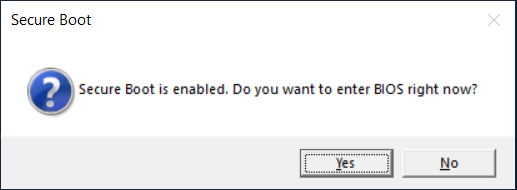

---

## layout: default title: How to Disable Secure Boot — PhantomHack

# 🔒 Как отключить Secure Boot / How to Disable Secure Boot

Secure Boot — это функция безопасности UEFI, которая при загрузке компьютера разрешает запуск только программного обеспечения с доверенной цифровой подписью Microsoft. Наш продукт использует низкоуровневые техники, которые Secure Boot целенаправленно блокирует — именно поэтому для корректной работы его необходимо отключить.

Secure Boot is a UEFI security feature that only allows software with a trusted Microsoft digital signature to run during startup. Our product relies on low-level techniques that Secure Boot is specifically designed to block — that is why it must be disabled for the software to work correctly.

---

## Шаг 1 — Войти в BIOS/UEFI / Step 1 — Enter BIOS/UEFI

---

### ⚡ Способ 1 — Через лоадер (быстрее всего!) / Method 1 — Via Loader (Fastest!)

  

При запуске лоадер автоматически проверяет статус Secure Boot. Если он включён — на экране появится диалоговое окно. Нажмите **«Да»** — компьютер мгновенно перезагрузится прямо в меню BIOS, минуя загрузку Windows.

When the loader starts, it automatically checks the Secure Boot status. If enabled, a dialog box appears. Click **«Yes»** — the computer will instantly restart directly into BIOS, bypassing Windows boot.

---

### 🔑 Способ 2 — Горячие клавиши / Method 2 — Hotkeys at Startup

Сразу после включения компьютера нажимайте нужную клавишу несколько раз подряд, пока не откроется BIOS.

Press the key repeatedly right after turning on or restarting, until BIOS opens.

|Производитель / Brand|Клавиша / Key|
|---|---|
|ASUS|`Del` или `F2`|
|MSI|`Del`|
|Gigabyte / AORUS|`Del` или `F12`|
|ASRock|`Del` или `F2`|
|Lenovo|`F1` или `F2`|
|HP|`F10` или `Esc`|
|Acer|`Del` или `F2`|

> 💡 **Совет / Tip:** Нажимайте клавишу сразу после включения питания — ещё до появления логотипа Windows. / Press the key immediately after powering on — before the Windows logo appears.

---

### 🪟 Способ 3 — Через Windows / Method 3 — Via Windows Recovery

Если компьютер загружается слишком быстро — используйте этот способ. / If your computer boots too fast, use this method instead.

🇷🇺 Удерживайте `Shift` и нажмите **«Перезагрузка»** в меню Пуск → **«Диагностика»** → **«Дополнительные параметры»** → **«Параметры встроенного ПО UEFI»** → **«Перезапустить»**

🇺🇸 Hold `Shift` and click **"Restart"** in Start menu → **"Troubleshoot"** → **"Advanced options"** → **"UEFI Firmware Settings"** → **"Restart"**

---

## Шаг 2 — Отключить Secure Boot / Step 2 — Disable Secure Boot

Найдите свой бренд ниже и следуйте инструкции. / Find your brand below and follow the steps.

---

### 🔷 ASUS

> Путь / Path: `Boot → Secure Boot → OS Type → Other OS`

🇷🇺

1. Войдите в BIOS (`Del` или `F2`)
2. Переключитесь в Advanced Mode (`F7`)
3. Откройте вкладку **Boot** → **Secure Boot**
4. В поле **OS Type** установите **Other OS** — Secure Boot отключится автоматически
5. Нажмите `F10` → **OK**

🇺🇸

1. Enter BIOS (`Del` or `F2`)
2. Switch to Advanced Mode (`F7`)
3. Open **Boot** tab → **Secure Boot**
4. Set **OS Type** to **Other OS** — Secure Boot disables automatically
5. Press `F10` → **OK**

📸 [Подробнее со скриншотами — remontka.pro](https://remontka.pro/secure-boot-disable/)

📸 [Detailed guide with screenshots — It's FOSS](https://itsfoss.com/disable-secure-boot-windows/)

---

### 🔷 MSI

> Путь / Path: `Settings → Advanced → Windows OS Configuration → Secure Boot → Disabled`

🇷🇺

1. Войдите в BIOS (`Del`)
2. Нажмите `F7` → Advanced Mode
3. Перейдите: **Settings → Advanced → Windows OS Configuration**
4. Найдите **Secure Boot** → установите **Disabled**
5. Нажмите `F10` → **Yes**

🇺🇸

1. Enter BIOS (`Del`)
2. Press `F7` → Advanced Mode
3. Navigate to: **Settings → Advanced → Windows OS Configuration**
4. Find **Secure Boot** → set to **Disabled**
5. Press `F10` → **Yes**

---

### 🔷 Gigabyte / AORUS

> Путь / Path: `Boot → Secure Boot Enable → Disabled`

🇷🇺

1. Войдите в BIOS (`Del`)
2. В Easy Mode нажмите `F2` → Classic/Advanced Mode
3. Откройте вкладку **Boot**
4. Найдите **Secure Boot Enable** → установите **Disabled**
5. Нажмите `F10`

🇺🇸

1. Enter BIOS (`Del`)
2. In Easy Mode press `F2` → Classic/Advanced Mode
3. Go to **Boot** tab
4. Find **Secure Boot Enable** → set to **Disabled**
5. Press `F10`

---

### 🔷 ASRock

> Путь / Path: `Security → Secure Boot → Disabled`

🇷🇺

1. Войдите в BIOS (`Del` или `F2`)
2. Перейдите на вкладку **Security**
3. Найдите **Secure Boot** → установите **Disabled**
4. Нажмите `F10`

🇺🇸

1. Enter BIOS (`Del` or `F2`)
2. Go to **Security** tab
3. Find **Secure Boot** → set to **Disabled**
4. Press `F10`

---

### 🔷 Lenovo (ноутбуки / Laptops)

> Путь / Path: `Security → Secure Boot → Disabled`

🇷🇺

1. Включите устройство → при появлении логотипа Lenovo нажмите `Enter`, затем `F1` (или сразу `F2`)
2. Перейдите на вкладку **Security**
3. Выберите **Secure Boot** → установите **Disabled**
4. Нажмите `F10` и подтвердите

🇺🇸

1. Power on → when Lenovo logo appears, press `Enter`, then `F1` (or press `F2` immediately)
2. Go to **Security** tab
3. Select **Secure Boot** → set to **Disabled**
4. Press `F10` and confirm

---

### 🔷 HP (ноутбуки / Laptops)

> Путь / Path: `Security → Secure Boot Configuration → Disabled`

🇷🇺

1. Войдите в BIOS (`F10`, или `Esc` → затем `F10`)
2. Перейдите на вкладку **Security**
3. Выберите **Secure Boot Configuration**
4. Снимите галочку или установите **Disabled**
5. Нажмите **Save** → подтвердите и выйдите

🇺🇸

1. Enter BIOS (`F10`, or `Esc` → then `F10`)
2. Go to **Security** tab
3. Select **Secure Boot Configuration**
4. Uncheck Secure Boot or set to **Disabled**
5. Click **Save** → confirm and exit

---

### 🔷 Acer (ноутбуки / Laptops)

> Путь / Path: `Boot → Secure Boot → Disabled`

🇷🇺

1. Войдите в BIOS (`Del`, `F2` или `F12`)
2. Перейдите на вкладку **Boot** (на некоторых моделях — **Security**)
3. Найдите **Secure Boot** → установите **Disabled**
4. Нажмите `F10`

🇺🇸

1. Enter BIOS (`Del`, `F2`, or `F12`)
2. Go to **Boot** tab (on some models — **Security**)
3. Find **Secure Boot** → set to **Disabled**
4. Press `F10`

---

## Шаг 3 — Сохранить и выйти / Step 3 — Save and Exit

🇷🇺 На любой плате после внесения изменений нажмите `F10` (или перейдите в **Save & Exit**) и подтвердите. Компьютер перезагрузится — Secure Boot будет отключён.

🇺🇸 On any board, after making changes press `F10` (or go to **Save & Exit**) and confirm. The computer will restart with Secure Boot disabled.

---

## ⚠️ Опция Secure Boot серая / Secure Boot Option Is Grayed Out?

🇷🇺 Если пункт Secure Boot отображается серым — большинство производителей защищают настройки BIOS паролем администратора. Решение:

🇺🇸 If the Secure Boot option is grayed out — most manufacturers protect BIOS settings with an admin password. Solution:

🇷🇺

1. Перейдите в **Security** → **Set Supervisor Password** (или **Set Administrator Password**)
2. Введите любой пароль (например, `1234`) и подтвердите
3. Сохраните: `F10` → **Yes**
4. Снова войдите в BIOS — Secure Boot теперь доступен
5. После отключения Secure Boot удалите пароль: вернитесь в **Set Supervisor Password**, оставьте поля пустыми и сохраните

🇺🇸

1. Go to **Security** → **Set Supervisor Password** (or **Set Administrator Password**)
2. Enter any password (e.g., `1234`) and confirm
3. Save: `F10` → **Yes**
4. Re-enter BIOS — Secure Boot will now be editable
5. After disabling Secure Boot, remove the password: go back to **Set Supervisor Password**, leave both fields empty, and save

---

## 🔗 Полезные ссылки / Useful Links

- 🇷🇺 [Remontka.pro — Как отключить Secure Boot (со скриншотами)](https://remontka.pro/secure-boot-disable/)
- 🇺🇸 [It's FOSS — How to Disable UEFI Secure Boot in Windows (with screenshots)](https://itsfoss.com/disable-secure-boot-windows/)
- 🇺🇸 [Pure Infotech — How to Disable Secure Boot on Windows 11](https://pureinfotech.com/disable-secure-boot-windows-11/)

---

Если Secure Boot по-прежнему не отключается или возникают другие трудности — уточните точную модель вашей материнской платы или ноутбука и обратитесь в поддержку.

If Secure Boot still won't disable or you encounter other issues — find the exact model of your motherboard or laptop and contact support.