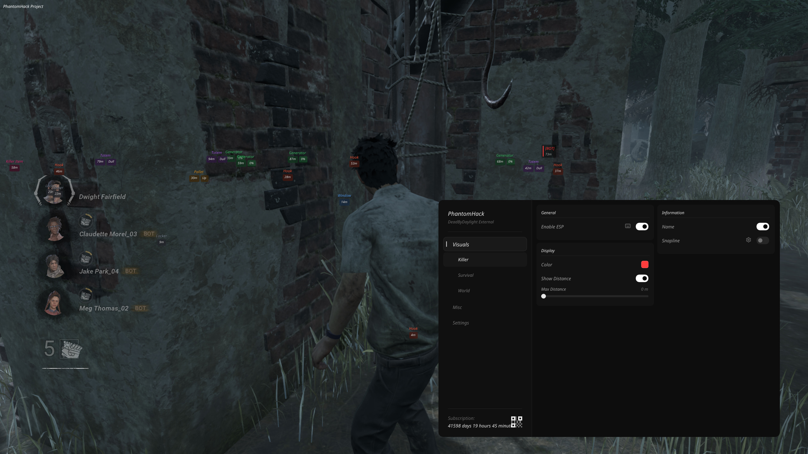
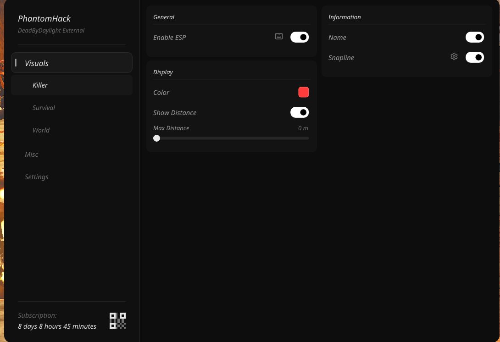
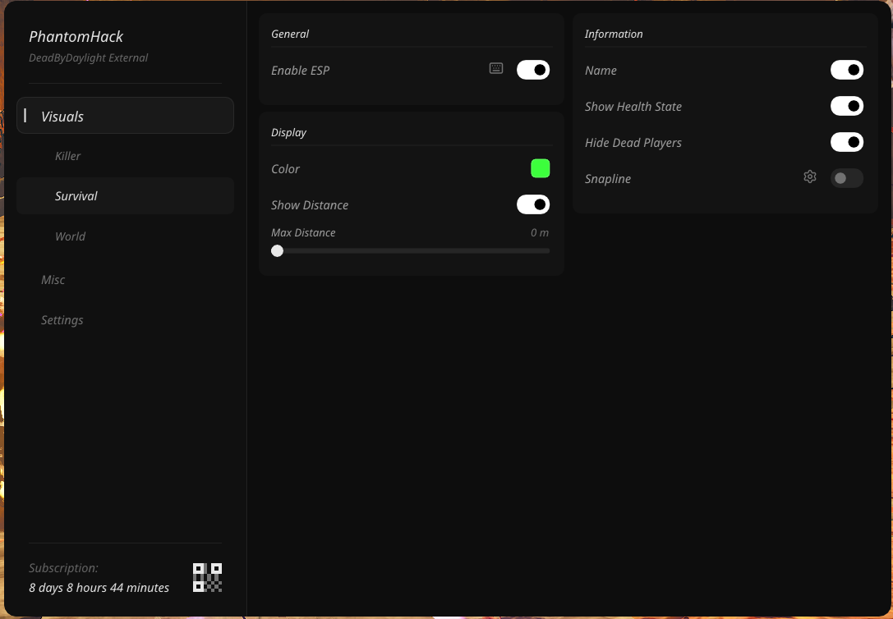
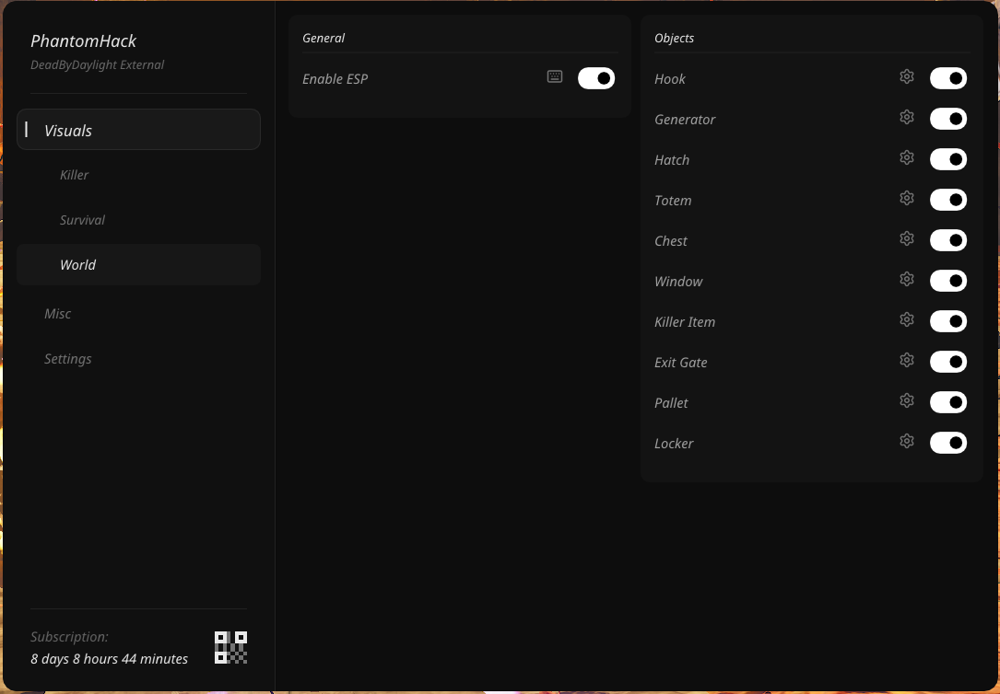
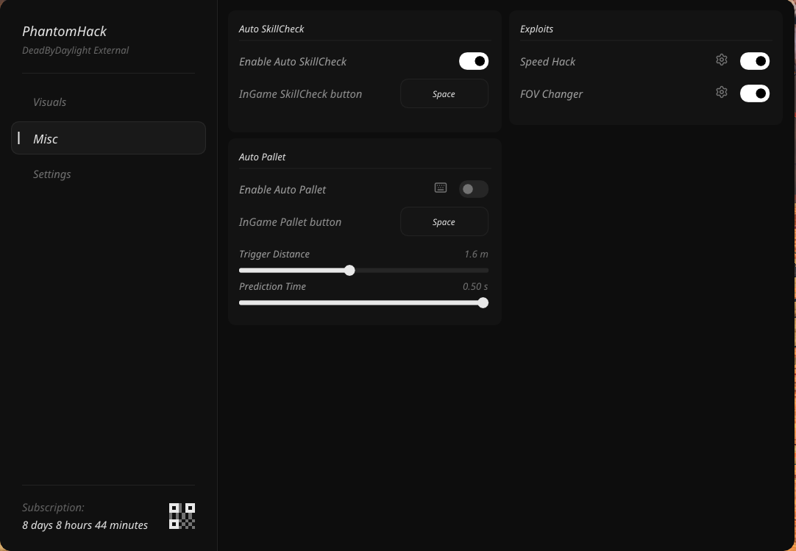
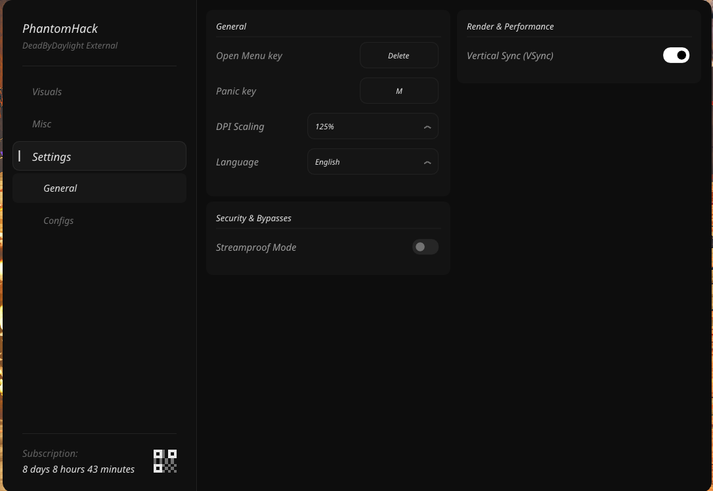

# PhantomHack — Dead by Daylight External

🟢 **Status:** Undetected  
🔵 **Supported OS:** Windows 10 / Windows 11 (All builds)  
🔴 **Platforms:** Steam, Epic Games

---

## 🇺🇸 English Description

**PhantomHack: Dead by Daylight External** is a premium, high-performance security-focused software designed for the ultimate competitive edge for both Killer and Survivor roles. Operating strictly at the system kernel level (Kernel-Mode Driver), it ensures maximum safety, bypasses Easy Anti-Cheat (EAC) user-mode detections, and guarantees rock-solid stability.

**Key Advantages:**

- **Kernel-Level Execution:** The software operates via a custom kernel driver, completely separating its memory operations from EAC detection routines.
- **True External Overlay:** Seamlessly renders overlay visuals (ESP for Survivors, Killers, Generators, Totems, Hatch, Pallets, Windows, Lockers, and more) in Windowed and Borderless modes without performance drops.
- **Universal OS Support:** Fully optimized and compatible with Windows 10 and Windows 11 (all latest builds).
- **Advanced Configuration System:** Dynamic configuration profiles with dedicated presets tailored specifically for Survivor and Killer gameplay.

---

## 🇷🇺 Описание на Русском

**PhantomHack: Dead by Daylight External** — это высокотехнологичное приватное ПО, созданное для получения максимального преимущества в игре как за Выживших, так и за Убийц. Благодаря работе исключительно на уровне ядра системы (Kernel-Mode Driver), софт обеспечивает наивысшую степень безопасности, гарантированно обходит системы защиты Easy Anti-Cheat (EAC) и обеспечивает абсолютную стабильность.

**Ключевые преимущества:**

- **Работа на уровне ядра (Kernel):** Чит использует кастомный драйвер ядра, надёжно изолируя свои процессы от систем обнаружения EAC в user-mode.
- **Полноценный External Оверлей:** Визуальные функции (ESP на игроков, генераторы, тотемы, люки, паллеты, окна, шкафчики и другие объекты) корректно отображаются во всех режимах игры (в окне, без рамки) без потери FPS.
- **Универсальная совместимость:** Полная поддержка и оптимизация для Windows 10 и Windows 11 (включая последние обновления).
- **Гибкая система настроек:** Динамическое сохранение конфигураций и поддержка индивидуальных профилей под роли Выжившего и Убийцы.

---

## 🛠 Feature List / Список функций

---

### 1. Killer Visuals / Визуалы Убийцы

**👁 Enable ESP / Включение ESP** EN: Toggle Killer visuals with hotkey binding option. RU: Включение отображения Убийцы с возможностью привязки к горячей клавише.

**🎨 ESP Color / Цвет отображения** EN: Customizable color palette for Killer visual elements. RU: Выбор индивидуального цвета подсветки Убийцы.

**📏 Show Distance & Max Distance / Дистанция и Ограничение расстояния** EN: Toggle distance display and adjust maximum render range in meters. RU: Отображение расстояния до Убийцы и настройка максимальной дистанции.

**🏷 Show Name / Имя Убийцы** EN: Displays the Killer's character name. Automatically labels bots with [BOT] tag. RU: Отображение имени Убийцы. Боты автоматически помечаются тегом [BOT].

**📍 Snaplines / Линии к цели (Снаплайны)** EN: Draws directional lines pointing towards the Killer with custom Color, Thickness, and 9-point Screen Origin selector. Lines automatically clamp to screen edges when the Killer is off-screen. RU: Линии к Убийце с настройкой цвета, толщины и точки исхождения (9 вариантов). Линии автоматически прижимаются к краям экрана, если Убийца вне поля зрения.

---

### 2. Survivor Visuals / Визуалы Выживших

**👁 Enable ESP / Включение ESP** EN: Toggle Survivor visuals with hotkey binding option. RU: Включение отображения Выживших с возможностью привязки к горячей клавише.

**🎨 ESP Color / Цвет отображения** EN: Customizable color palette for Survivor visual elements. RU: Выбор индивидуального цвета подсветки Выживших.

**📏 Show Distance & Max Distance / Дистанция и Ограничение расстояния** EN: Toggle distance display and adjust maximum render range in meters. RU: Отображение расстояния до Выживших и настройка максимальной дистанции.

**🏷 Show Name / Имя игрока** EN: Displays Survivor character/player names. Automatically labels bots with [BOT] tag. RU: Отображение имён Выживших. Боты автоматически помечаются тегом [BOT].

**🩺 Show Health State / Статус здоровья** EN: Displays the current health status of each Survivor rendered on a Player Card (Healthy, Injured, Dying, Dead). RU: Отображение текущего статуса здоровья Выживших на карточке игрока (Здоров, Ранен, Умирает, Мёртв).

**💀 Hide Dead Players / Скрывать мёртвых** EN: Automatically hides visuals for sacrificed or killed players to keep the screen clean. RU: Автоматически скрывает подсветку погибших игроков, чтобы не засорять экран.

**📍 Snaplines / Линии к цели (Снаплайны)** EN: Draws directional lines pointing towards Survivors with custom Color, Thickness, and 9-point Screen Origin selector. Lines automatically clamp to screen edges when a Survivor is off-screen. RU: Линии к Выжившим с настройкой цвета, толщины и точки исхождения (9 вариантов). Линии автоматически прижимаются к краям экрана, если Выживший вне поля зрения.

**🪪 Player Card / Карточка игрока** EN: Each Survivor and Killer is displayed as a stylized on-screen card showing name, distance, and health state with a colored accent bar matching the configured ESP color. RU: Каждый Выживший и Убийца отображается в виде стилизованной карточки на экране с именем, дистанцией и статусом здоровья с цветовым акцентом в соответствии с настройкой ESP.

---

### 3. World Visuals / Визуалы Окружения (World)

**👁 Enable World ESP / Включение ESP окружения** EN: Master toggle for all world object visuals with hotkey binding option. RU: Главный переключатель отображения объектов карты с возможностью привязки к горячей клавише.

---

**🪝 Hook ESP / Крюки** EN: Highlights meat hooks across the map with configurable color, max render distance and distance label. RU: Подсветка крюков с настройкой цвета (Color), радиуса отрисовки (Max Distance) и дистанции (Show Distance).

**⚡ Generator ESP / Генераторы** EN: Detailed generator overlay with real-time repair progress %, blocked state badge, and smart filters (Hide Repaired, Hide Blocked). RU: Подсветка генераторов с отображением % прогресса починки (Show Progress), статуса блокировки (Show Blocked), а также фильтрами скрытия починенных (Hide Repaired) и заблокированных генераторов (Hide Blocked).

**🚪 Hatch ESP / Люк** EN: Highlights the hatch with full state detection (Open, Closed, Hidden) and selective visibility filters (Show Closed, Show Open). RU: Отображение люка с полным определением его состояния (Открыт, Закрыт, Скрыт) и фильтрами (Show Closed, Show Open).

**💀 Totem ESP / Тотемы** EN: Comprehensive totem tracking with real-time state recognition (Dull, Hex, Boon, Cleansed) and selective filtering (Hide Dull, Hide Cleansed, Hide Boon, Hide Hex). RU: Полная подсветка тотемов с определением состояния (Тусклый, Проклятый, Дар, Очищен) и фильтрами (Hide Dull, Hide Cleansed, Hide Boon, Hide Hex).

**📦 Chest ESP / Сундуки** EN: Displays supply chests for finding items with configurable color and max render distance. RU: Подсветка сундуков с настройкой цвета (Color) и расстояния (Max Distance).

**🪟 Window ESP / Окна (Оконные проёмы)** EN: Highlights vault windows, shows blocked state badge, and lets you hide Entity-blocked windows (Hide Blocked). RU: Подсветка оконных проёмов с отображением статуса блокировки и функцией скрытия заблокированных окон (Hide Blocked).

**🧰 Killer Item ESP / Предметы Убийц** EN: Displays killer-specific interactable objects (Traps, Jigsaw Boxes, Vaccines, Fountains, etc.) with configurable color and render range. RU: Подсветка особых предметов Убийц (капканы, ящики Пилы, вакцины, фонтаны и т.д.) с настройкой цвета и дистанции.

**🚪 Exit Gate ESP / Ворота (Выходы)** EN: Highlights exit gates with configurable color and distance indicator. RU: Отображение ворот эвакуации с настройкой цвета и расстояния.

**🪵 Pallet ESP / Паллеты (Доски)** EN: Highlights pallets with real-time state display (Up, Fallen, Destroyed) and smart filters (Hide Dropped, Hide Broken). RU: Подсветка паллет с отображением состояния (Стоит, Сброшена, Сломана) и фильтрами (Hide Dropped, Hide Broken).

**🗄️ Locker ESP / Шкафчики** EN: Highlights lockers with configurable color, max render distance, and distance label. RU: Подсветка шкафчиков с настройкой цвета (Color), максимальной дистанции (Max Distance) и отображения расстояния (Show Distance).

---

### 4. Miscellaneous & Exploits / Разное и Эксплойты (Misc)

**Auto SkillCheck / Автоматический Скиллчек**

🎯 **Enable Auto SkillCheck / Включение Авто-Скиллчека** EN: Automatically passes in-game Skill Checks with Great/Perfect timing while repairing generators, healing, or struggling. Supports all Skill Check types including Wiggle checks. RU: Автоматическое идеальное прохождение скиллчеков при ремонте генераторов, лечении и борьбе. Поддерживает все типы скиллчеков, включая проверки при вырывании.

⌨️ **InGame SkillCheck button / Внутриигровая клавиша Скиллчека** EN: Binds the in-game key responsible for triggering Skill Checks (default: Space). RU: Настройка клавиши для нажатия скиллчеков (по умолчанию Пробел).

---

**Auto Pallet / Автоматический Сброс Паллеты**

🪵 **Enable Auto Pallet / Включение Авто-Паллеты** EN: Automatically drops the nearest standing pallet when the Killer approaches within the configured trigger distance, with optional keybind activation. Uses predictive positioning based on Killer velocity to time the drop precisely. RU: Автоматически сбрасывает ближайшую стоячую паллету, когда Убийца подходит на заданное расстояние. Использует предсказание позиции Убийцы на основе его скорости для точного тайминга сброса. Поддерживает привязку к горячей клавише.

⌨️ **Pallet button / Клавиша сброса паллеты** EN: Binds the in-game key responsible for dropping pallets (default: Space). RU: Настройка клавиши для сброса паллеты (по умолчанию Пробел).

📏 **Trigger Distance / Дистанция срабатывания** EN: Sets the maximum distance in meters at which the pallet is dropped when the Killer is predicted to reach it (0.5m – 3.0m). RU: Настройка максимальной дистанции в метрах, при которой паллета сбрасывается по предсказанной позиции Убийцы (0.5м – 3.0м).

⏱ **Predict Time / Время предсказания** EN: Sets how many seconds ahead the Killer's position is predicted for drop timing (0.00s – 0.50s). RU: Настройка времени предсказания позиции Убийцы в секундах (0.00с – 0.50с).

---

**Exploits / Эксплойты**

⚡ **Speed Hack / Ускорение (Спидхак)** EN: Adjusts your character's movement speed beyond normal limits using a precise speed slider (0% – +10.0%). RU: Увеличение скорости перемещения персонажа с точной настройкой ползунка (0% – +10.0%).

🔭 **FOV Changer / Изменение поля зрения** EN: Adjusts the in-game camera Field of View to a custom value (60° – 150°). RU: Изменение угла обзора камеры (поле зрения) на произвольное значение (60° – 150°).

---

### 5. General Settings / Общие настройки

**General / Основные**

⌨️ **Open Menu key / Клавиша открытия меню** EN: Customizable hotkey to open or hide the software interface (default: Insert). RU: Настройка горячей клавиши для вызова и скрытия меню (по умолчанию Insert).

🚨 **Panic key / Экстренное отключение (Паник-клавиша)** EN: Emergency hotkey to instantly disable all active features and unload visuals. RU: Горячая клавиша экстренного выключения всех функций и скрытия чита.

🔍 **DPI Scaling / Масштабирование меню** EN: Adjusts the UI scaling percentage to fit various monitor resolutions (100%, 125%, 150%, etc.). RU: Изменение масштаба интерфейса меню под любые разрешения экранов.

🌐 **Language / Язык интерфейса** EN: Switch menu localization on the fly (Available: English, Russian, Ukrainian). RU: Мгновенный переключатель языка меню (Доступны: Английский, Русский, Украинский).

---

**Security & Bypasses / Безопасность и Защита**

🎥 **Streamproof Mode / Скрытие на стримах и записи** EN: Completely hides all ESP visuals and overlay elements from recording/streaming software (OBS, Discord, Twitch, ShadowPlay). RU: Полное скрытие визуалов и меню чита от программ записи и трансляции (OBS, Discord, Twitch, GeForce Experience).

---

**Render & Performance / Рендер и Производительность**

🔄 **Vertical Sync (VSync) / Вертикальная синхронизация** EN: Locks overlay frame rate to monitor refresh rate to eliminate screen tearing and minimize CPU/GPU load. RU: Синхронизация кадров оверлея с герцовкой монитора для устранения разрывов изображения и снижения нагрузки на систему.